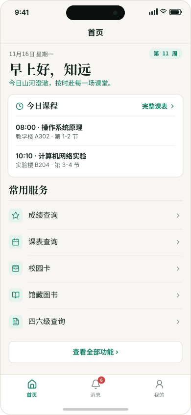
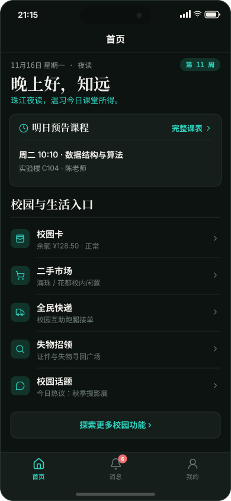
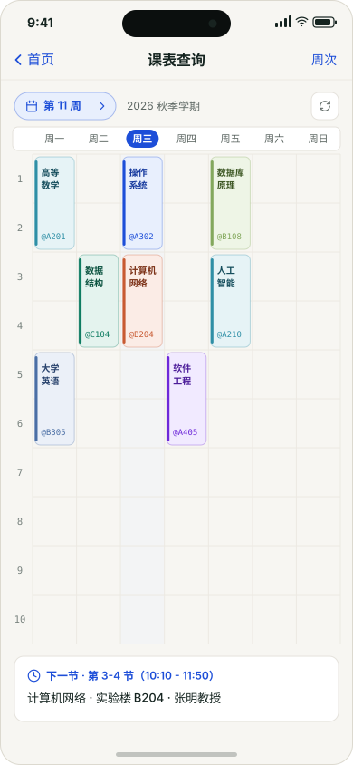
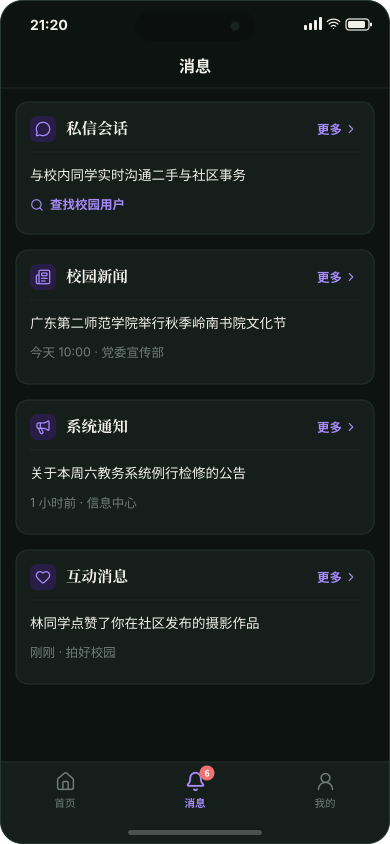
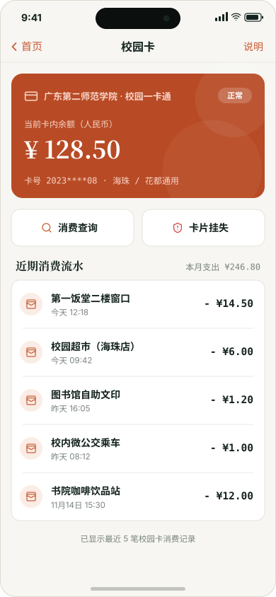
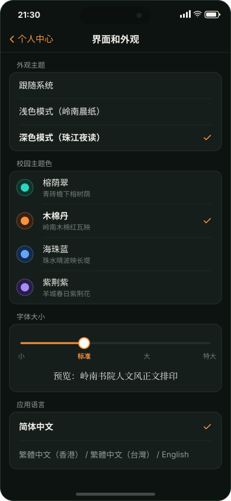

# 广东二师助手 · iOS 客户端

广东第二师范学院校园助手的 iOS 客户端，SwiftUI 编写，支持 iOS 17 及以上。

这个仓库只有客户端。成绩、课表、校园卡这些数据来自 [GdeiAssistant 后端](https://github.com/GdeiAssistant/GdeiAssistant)，本仓库不包含服务端代码和部署配置。项目由学生维护，不是学校官方服务。

- [功能](#功能)
- [技术栈](#技术栈)
- [快速开始](#快速开始)
- [接口环境](#接口环境)
- [工程结构](#工程结构)
- [架构说明](#架构说明)
- [界面预览](#界面预览)
- [参与贡献](#参与贡献)

## 功能

| 模块 | 内容 |
| --- | --- |
| 教务 | 成绩、课表、四六级、考研、教室、图书馆、教学评价、数据中心 |
| 校园生活 | 二手交易、全民快递、失物招领、校园树洞、卖室友、表白墙、校园话题、拍好校园 |
| 资讯 | 新闻通知、系统公告、互动消息、私信会话 |
| 个人中心 | 资料与头像、绑定手机/邮箱、隐私设置、登录记录、数据下载、主题与字体、反馈、设置 |

社交实时通道走 WebSocket（`/api/social/realtime`），由 `SocialRealtimeManager` 管认证、重连和登出清理。

## 技术栈

Swift · SwiftUI · MVVM · Repository Pattern · URLSession · Keychain · JWT

## 快速开始

### 环境要求

- Xcode 26.3 及以上
- iOS 17 SDK
- 完整的 Xcode，不是只有 Command Line Tools

如果 `xcode-select` 指向的不是完整 Xcode：

```bash
sudo xcode-select -s /Applications/Xcode.app/Contents/Developer
```

### 打开工程

```bash
open GdeiAssistant-iOS.xcodeproj
```

### 命令行构建

```bash
DEVELOPER_DIR=/Applications/Xcode.app/Contents/Developer \
xcodebuild -project GdeiAssistant-iOS.xcodeproj \
  -scheme GdeiAssistant-iOS \
  -destination 'generic/platform=iOS' \
  CODE_SIGNING_ALLOWED=NO CODE_SIGNING_REQUIRED=NO build
```

### 本地检查

```bash
./Tools/check_style.sh
python3 Tools/check_localization.py
```

### 发布 TestFlight

仓库提供 `iOS TestFlight Release` 手动工作流：签名归档、导出 IPA，按需上传 TestFlight。即使跳过上传，也会保留导出的 IPA artifact，方便排查签名问题。

发布前在仓库或 `ios-production` environment 配置：

| 名称 | 内容 |
| --- | --- |
| `IOS_CERTIFICATE_P12_BASE64` | Apple Distribution 证书 p12 的 base64 |
| `IOS_CERTIFICATE_PASSWORD` | p12 密码 |
| `IOS_PROVISIONING_PROFILE_BASE64` | App Store provisioning profile 的 base64 |
| `IOS_DEVELOPMENT_TEAM` | Apple Developer Team ID |
| `APP_STORE_CONNECT_API_KEY_ID` | App Store Connect API Key ID |
| `APP_STORE_CONNECT_ISSUER_ID` | App Store Connect Issuer ID |
| `APP_STORE_CONNECT_API_KEY_BASE64` | App Store Connect `.p8` 私钥的 base64 |

可选：`IOS_APP_BUNDLE_ID` 覆盖默认 Bundle ID（默认 `cn.gdeiassistant.GdeiAssistant-iOS`）。工作流输入为 `version`、`build_number` 和是否上传 TestFlight，执行前会先跑 Swift 样式检查。

## 接口环境

通过 `Configs/*.xcconfig` 管理三套环境：

| 配置文件 | 环境 | 地址 |
| --- | --- | --- |
| `Configs/Debug.xcconfig` | `dev` | `http://localhost:8080/api` |
| `Configs/Staging.xcconfig` | `staging` | `https://gdeiassistant.azurewebsites.net/api` |
| `Configs/Release.xcconfig` | `prod` | `https://gdeiassistant.azurewebsites.net/api`（默认）；正式发布可通过 `GDEI_API_BASE_URL_PRODUCTION=https://gdeiassistant.cn/api` 覆盖 |

Debug 构建可以在设置页切换 `dev / staging / prod` 和 `mock / remote`；Staging / Release 构建固定走远程接口，不读 debug 期间留下的覆盖值。

命令行打测试环境包：

```bash
DEVELOPER_DIR=/Applications/Xcode.app/Contents/Developer \
xcodebuild -project GdeiAssistant-iOS.xcodeproj \
  -scheme GdeiAssistant-iOS \
  -configuration Release \
  -xcconfig Configs/Staging.xcconfig \
  -destination 'generic/platform=iOS' \
  CODE_SIGNING_ALLOWED=NO CODE_SIGNING_REQUIRED=NO build
```

## 工程结构

```text
GdeiAssistant-iOS/
├── App/
├── Core/
│   ├── Auth/           登录态与 Token
│   ├── Config/         环境配置
│   ├── DesignSystem/   颜色、字号、组件
│   ├── Networking/     请求构建与错误归一化
│   ├── Storage/        Keychain、UserDefaults
│   └── Utils/
├── Features/           按业务域拆分，每个域含 Models/DTOs/Mappers/Repositories/ViewModels/Views
└── Mock/
```

## 架构说明

### 数据源

`remote` 请求真实接口，`mock` 使用本地模拟数据。Debug 构建在设置页切换，即时生效；Staging / Release 固定远程。

mock 数据只用于界面联调和主链路验证，不是真实校园业务数据。测试账号密码不要写进公开发行说明。

### 登录态

`AuthManager` 负责登录、登出、恢复登录态和 401 失效处理；`SessionState` 持有全局登录状态和当前用户；`KeychainTokenStorage` 存 JWT；`AuthRepository` 按环境在 mock 和 remote 之间切换。

### 网络层

`URLSession` 统一处理请求构建（GET/POST/PUT/DELETE）、Header 与 `X-Client-Type: IOS` 注入、Bearer Token 注入、JSON 解码、错误归一化（契约 `errorCode` 映射到 `NetworkError.contract`），以及 401 与登录失效。

### DTO / Domain 分层

远端数据不直接进 View。`DTO` 承接后端结构，`Mapper` 转成领域模型，`Repository` 对 ViewModel 暴露稳定的数据接口。社交模块在 `Features/Social`，通过 `SocialAssembly` 注入，共享契约见 [GdeiAssistant 社交架构契约](https://github.com/GdeiAssistant/GdeiAssistant/blob/master/docs/social-messaging.md)。

### 主题

采用《岭南书院人文风》（Warm Editorial Lingnan Academy）设计系统，由 `GeneratedDesignTokens.swift` 与 `DSColor.swift` 驱动：支持浅色「岭南晨纸」（`#F7F6F2`）、深色「珠江夜读」（`#0D1311`）和跟随系统，内置 **榕荫翠 / 木棉丹 / 海珠蓝 / 紫荆紫** 四套正交校园主题色、4 档字号及 Dynamic Type 适配，并通过 `Localizable.strings` 支持 6 种语言，偏好持久化在 `UserDefaults`。多端设计规范见 [主仓说明](https://github.com/GdeiAssistant/GdeiAssistant#设计系统)，本端效果见下方 [界面预览](#界面预览)。

## 界面预览

以下为 iOS 端基于《岭南书院人文风》（Lingnan Editorial）设计系统的 6 张统一尺寸移动端矢量界面预览，展示今日首页、课表、校园消息、校园卡与界面外观，涵盖浅色「岭南晨纸」、深色「珠江夜读」及四套校园主题色：

<p align="center">
  
  
  
</p>

<p align="center">
  
  
  
</p>

## 参与贡献

见 [CONTRIBUTING.md](CONTRIBUTING.md) 与组织行为准则 [CODE_OF_CONDUCT.md](https://github.com/GdeiAssistant/.github/blob/main/CODE_OF_CONDUCT.md)。安全问题请按 [SECURITY.md](SECURITY.md) 处理，不要在公开 Issue 里贴真实账号、验证码或密钥。

## 免责声明

本项目不代表学校官方服务。面向用户的协议、隐私政策、授权说明和功能限制，以 App 内对应页面展示的内容为准，本 README 不替代这些正文。发布衍生版本前，请自行确认隐私处理、校园凭证管理、iOS 权限说明、日志脱敏、密钥管理、Keychain 使用、签名配置和商标使用边界。

## 许可证

[Apache License 2.0](LICENSE) · [NOTICE](NOTICE) · [THIRD_PARTY_NOTICES.md](THIRD_PARTY_NOTICES.md) · [TRADEMARK.md](TRADEMARK.md)
